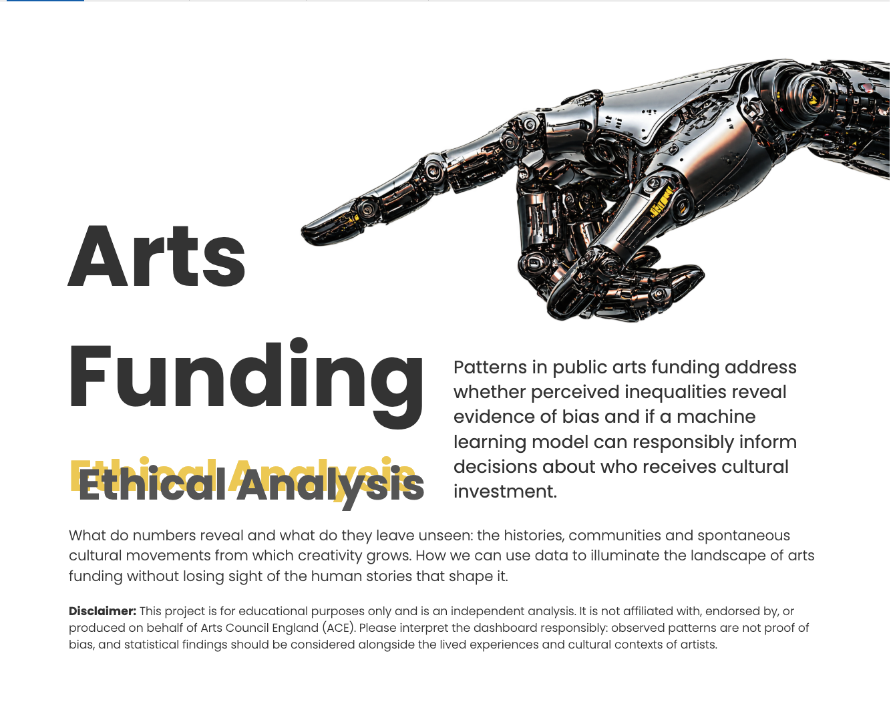
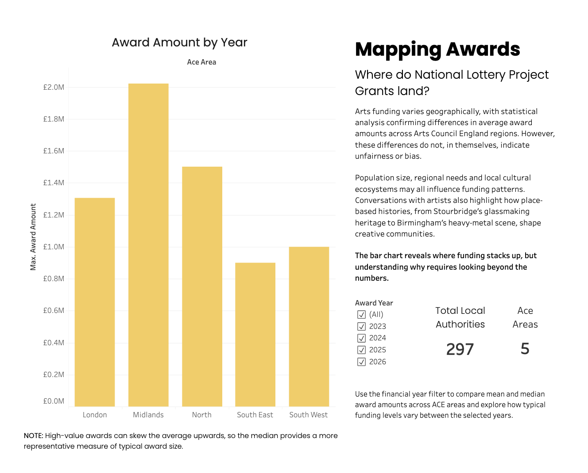
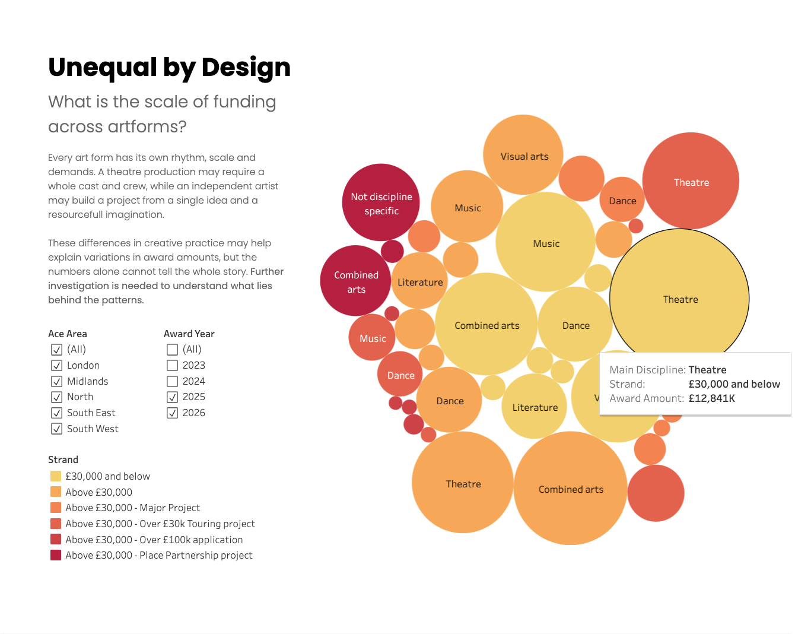
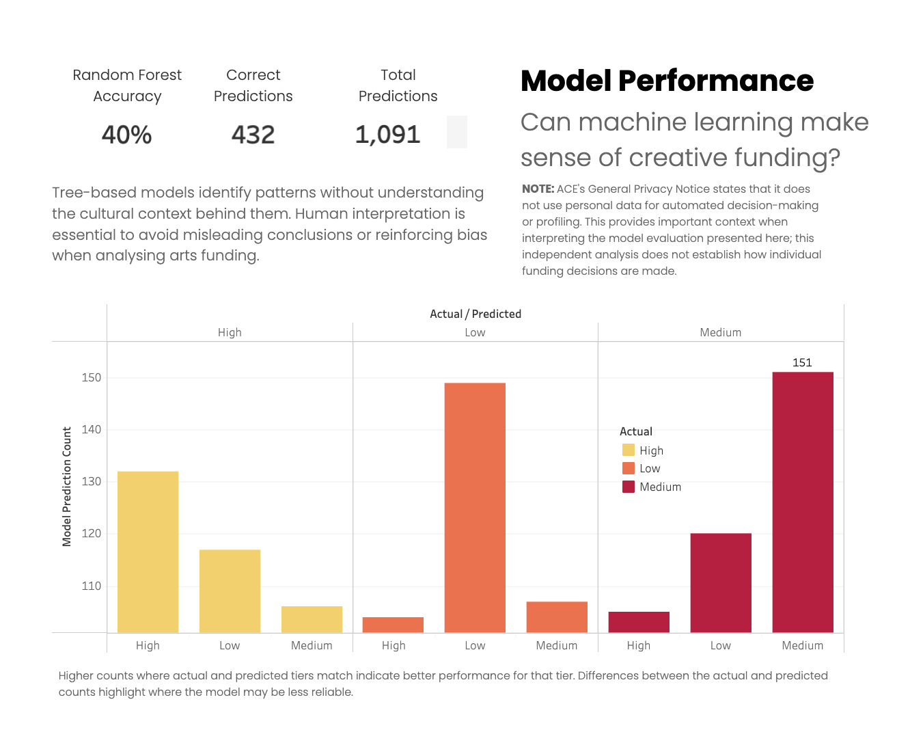
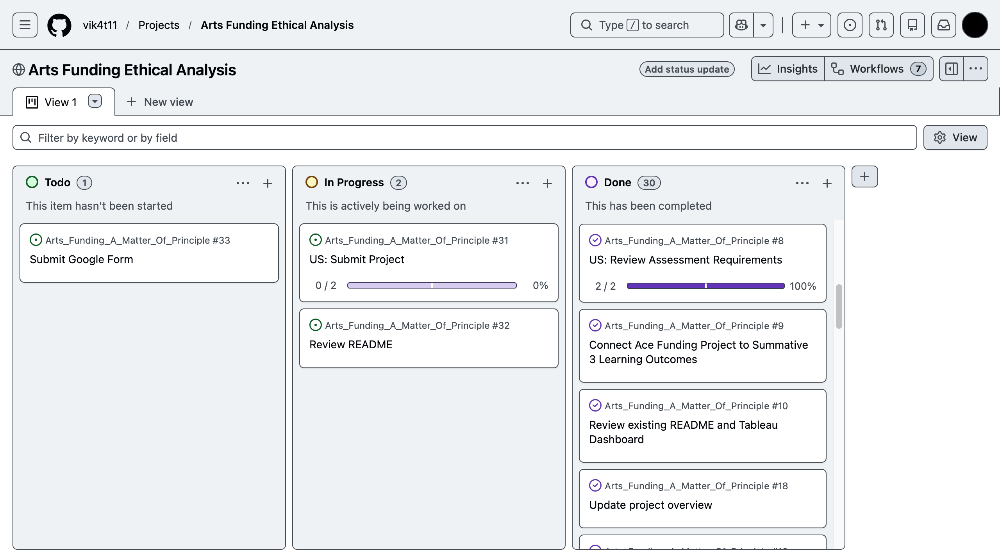

# <u>**Arts Funding: A Matter of Principle**</u>
### An Ethical Analysis of Arts Council England National Lottery Project Grants

*Arts Funding: A Matter of Principle* examines patterns in public arts funding, distinguishes perceived inequalities from evidence of bias and evaluates the ethical implications of using machine learning to inform funding decisions.

It is essential for stakeholders to interpret data and implement machine learning models responsibly. The nature of the arts sector lies in its unpredictability. Cultural shifts across art forms and regional growth driven by collective movements can emerge spontaneously, often beyond the reach of historical data. 

This analysis brings a human perspective to the limitations of reductive statistics, examining how quantifiable patterns can flatten the complexity of creative practice by overlooking the social, cultural and regional contexts shaping artistic development.

## <u>**Business Requirements**</u>

The requirements for Summative Assessment 3 is to present a critical evaluation of the ethical implications applying data analytics and machine learning onto public arts funding. The README demonstrates an understanding of data responsibility, model limitations and accountable decision-making.

**Review data handling:** Evaluate the dataset's source, licensing uncertainty, data preparation decisions and minimisation.

**Interpret data responsibly:** Examine regional and disciplinary differences in ACE National Lottery Project awards, distinguishing statistical disparities from evidence of bias.

**Evaluate model reliability:** Assess the Random Forest classification model using its existing performance metrics and determine whether its predictions are suitable for informing funding decisions.

**Identify risks of misrepresentation:** Consider how regional differences, disciplinary representation, class imbalance and missing contextual information may influence visualisations and model predictions.

**Consider human oversight:** Evaluate why machine learning predictions should not replace contextual assessment, professional judgement or accountable decision-making in arts funding.

**Communicate ethical findings:** Present the analysis, limitations and recommendations to non-technical stakeholders.

## <u>**Dataset**</u>

**Dataset used**: (1) National Lottery Project Grants - List of Awards in Year 2023-2024 and (2) National Lottery Project Grants - List of Awards in Year 2025-2026

**Source**: Arts Council – Project Grants Data

**Dataset link**: https://www.artscouncil.org.uk/ProjectGrants/project-grants-data

**Format**: EXCEL sheets exported as CSV files 

**Columns**: Recipient, activity name, award amount, decision date, decision month, decision quarter, ACE Area, local authority, main discipline and time-Limited Priority. 

## <u>**Data Licensing**</u> 

[Arts Council England – Project Grants Data](https://www.artscouncil.org.uk/ProjectGrants/project-grants-data) was downloaded from the official website. The [Open Government Licence v3.0](https://www.nationalarchives.gov.uk/doc/open-government-licence/version/3/) (OGL) allows data covered by the licence to be reused and adapted, provided the source is credited and the licence conditions are followed.

The third-party website [DOGE UK – Arts Council England Grant Data](https://doge-uk.com/funding/arts-council-england-all-grants/) lists the National Lottery Project Grants data under this licence. However, this could not be independently confirmed through ACE's own website. A search of ACE's listings [data.gov.uk](https://www.data.gov.uk/search?page=1&q=Catalogues&query=Catalogues) found other ACE datasets listed under the OGL, but not the specific dataset used in this project. 

In comparison, the [National Lottery Heritage Funds](https://www.heritagefund.org.uk/about/insight/open-data) explicitly states that its grant data is published under the OGL and available for reuse. It identifies policymakers, researchers, journalists, heritage organisations, potential applicants and the public as intended audiences. This illustrates how clear licensing information can support access to public funding data, although the Heritage Fund's arrangements do not confirm the licence applicable to ACE's data.

The next step is to contact ACE to confirm the applicable licence terms and review whether the dataset should remain publicly available in the repository.

## <u>**Freedom of Information and Transparency**</u>

The [Information Commissioner's Office (ICO)](https://ico.org.uk/for-organisations/foi/what-is-the-foi-act-and-are-we-covered/) explains that the Freedom of Information Act 2000 gives the public the right to request recorded information held by public authorities. It also requires public authorities to publish certain information about their activities. This supports transparency and public accountability.

In the context of arts funding, access to information can help researchers and the public better understand how public funding is distributed. However, published grant data alone cannot explain every funding decision or establish whether inequalities are evidence of bias. Further information, such as assessment criteria and application success rates, may be needed to understand the wider context.

## <u>**Hypothesis**</u>

The initial hypothesis motivating this project stems from a familiar question within the arts sector: *Are National Lottery Project Grants fairly distributed across regions, artforms and funding streams?*

This project is underpinned by the personal assumption that funding may not be distributed equally across the cultural sector, reflecting concerns many artists face when navigating public funding systems.

The following research questions apply descriptive analysis to examine funding patterns and investigate potential factors associated with differences in award amounts.

1. *Are ACE National Lottery Project Grants unevenly distributed across geographic areas?* The hypothesis is that award amounts and grant counts differ across ACE areas. This is investigated through a bivariate analysis in the EDA notebook, alongside Welch’s ANOVA to test whether the differences in mean award amounts between regions are statistically significant.

2. *Do certain main diciplines receive more or less funding than others?* Descriptive analysis compares award amounts across main disciplines to identify differences in funding distribution. Domain knowledge is then applied to interpret these patterns in the context of the cultural sector and consider potential explanations for differences in funding. 

3. *Can a machine-learning model predict award amount tiers with reasonable accuracy using categorical features?* Model accuracy is evaluated to assess how effectively machine learning can automate the prediction of award amount tiers using categorical features. Feature importance is also examined to identify which attributes contribute most to the model's predictions and reveal potential patterns in award amounts.

## <u>**Methodology**</u>

An end-to-end analytical workflow moves from raw data to an insightful dashboard, presenting discoveries from EDA alongside evaluation metrics for a simple machine-learning model designed to identify funding patterns.

**Data Collection** - Two publicly accessible ACE National Lottery Project Grants datasets (2023–2024 and 2025–2026) are loaded from the Arts Council website for this project.

**Extract, Transform, Load (ETL)** - Data integrity is ensured prior to analysis by standardising column names and inspecting and addressing missing, unique or duplicate records. Reviewing data types ensures numerical, date-time and categorical columns are compatible with plotting in the EDA notebook. The two datasets are joined, and a year column is added.

Columns containing personal identifiable information were removed to comply with Article 5(1)(c) of the GDPR. The final DataFrame is saved in the clean data folder.

**Exploratory Data Analysis (EDA)** - Award amount patterns are explored across ACE areas, main disciplines and funding streams using Pandas, NumPy, Matplotlib and Seaborn to visualise distributions and differences through boxplots, scatterplots, histograms and bar charts. 

Statistical techniques, including descriptive statistics and Welch’s ANOVA, complement these visualisations by summarising award distributions and testing whether mean award amounts differ significantly between ACE regions.

**Feature Engineering** - The clean, joined DataFrame undergoes further preparation for machine learning. Award amounts are grouped into funding tiers to create the target variable for multiclass classification. Columns that could cause data leakage and affect model quality are dropped, and the model DataFrame is saved.

**Machine‑Learning Model** - A Random Forest classification model is trained to predict award amount tiers (Low, Medium and High), using an 80/20 train-test split and stratified five-fold cross-validation. 

Model performance is evaluated using test accuracy, macro F1-score, precision, recall and a confusion matrix comparing actual and predicted tiers. Feature importance is then assessed to identify which attributes contribute most to the model's predictions.

**Dashboard Creation** - A Tableau dashboard frames visualisations and paints the numbers of year-on-year award amounts across ACE areas, main disciplines and funding streams. The interactive dashboard explores the research hypotheses, connecting the findings to reveal patterns in cultural funding. 

The dashboard also presents the multiclass machine-learning model's accuracy to assess how effectively it predicts award amount tiers and whether machine learning can identify meaningful patterns in creative funding.

## <u>**Analysis Techniques Used**</u>

**Descriptive Statistics** - Numerical statistics are reviewed to identify means, modes and percentiles, and to detect anomalies in columns that may require further inspection to ensure data quality and improve model performance. 

**Univariate Analysis** - Histograms, boxplots and bar charts are used to visualise the distribution of awards across numerical and categorical variables, exploring differences between geographic areas and whether certain main disciplines receive more or less funding.

**Bivariate Analysis** - Award amounts are compared across pairs of variables to examine differences in funding between categories and identify patterns in how much recipients receive.

**Outlier Inspection** - Anomalies identified in descriptive statistics are inspected to verify data quality and determine how they should be handled for the machine-learning model.

**Hypothesis Testing** - Welch’s ANOVA is applied to test whether mean award amounts differ significantly across ACE regions. The p-value is used to assess statistical significance and determine whether there is sufficient evidence to reject the null hypothesis.

## <u>**Hypothesis Validation**</u>

As the project developed, conversations with local artists challenged the original hypothesis, grounding the analysis in lived experience rather than quantitative features alone. These discussions highlighted how funding patterns may reflect the cultural ecosystems artists build around themselves.

For example, Stourbridge’s glassmaking heritage has shaped a distinct creative identity in the Black Country, whilst Birmingham’s heavy-metal legacy has produced generations of musicians. These local histories help explain how clusters of artistic activity emerge.

Above all, the project highlighted that data, whilst insightful, is not neutral. Patterns can be interpreted differently depending on the storyteller’s perspective, agenda or assumptions. Relying solely on statistical outputs or machine-learning predictions risked reinforcing bias by allowing initial assumptions to shape the narrative rather than the evidence.

**Are ACE National Lottery Project Grants unevenly distributed across geographic areas?**

**Result:** Supported

**Summary:** Welch’s ANOVA rejected the null hypothesis that mean award amounts are equal across ACE regions, providing statistical evidence of differences between regional averages.

The visual analysis also supports this finding, showing variation in award amounts despite positively skewed distributions.

However, these differences do not necessarily indicate unfair funding distribution. Further investigation considered potential explanations, including ACE’s strategic allocation of funding to areas in need and London’s higher population density, which may contribute to differences in the number of awards.

**Do certain main diciplines receive more or less funding than others?**

**Result:** Supported

**Summary:** Boxplots and barcharts show variation in award amounts across main disciplines. Theatre, Music and Dance appear to have higher award amounts, whilst Digital Arts appears to have lower award amounts in the dataset.

Based on domain knowledge of the arts sector, these differences may reflect the varied cost structures of creative practice, from large-scale theatre productions to small-scale independent artistic development. 

Nonetheless, this remains a potential explanation rather than a conclusion established by the visualisation and further investigation would be needed to establish the reasons for these differences.

**Can a machine-learning model predict award amount tiers with reasonable accuracy using categorical features?**

**Result:** Unsupported

**Summary:** The Random Forest classifier achieved a test accuracy of 39.60% and a macro F1-score of 39.56%. The confusion matrix showed that the model correctly classified 41.4% of Low-tier projects, 40.2% of Medium-tier projects and 37.2% of High-tier projects. These results indicate limited predictive performance, with substantial misclassification across all three award tiers.

Main discipline and ACE area were identified as influential predictors within the model. However, these rankings do not establish causation or explain individual funding decisions.

The results do not support using this model to reliably predict award amount tiers. Instead, they demonstrate the limitations of predicting complex cultural funding outcomes using a restricted set of categorical features.

## <u>Dashboard Overview</u>

The Tableau dashboard was adapted to incorporate an ethical review of the exploratory data analysis and machine-learning findings. A new cover page introduces the project's purpose and ethical considerations, while text boxes contextualise funding distributions, explain model performance and highlight the limitations of data-driven interpretations.

The dashboard explores the geographical distribution of ACE National Lottery Project Grants, compares award amounts across artistic disciplines and presents model evaluation metrics. Together, these visualisations examine patterns in public arts funding while emphasising the importance of transparency, human interpretation and responsible conclusions about potential inequalities.

#### **Dashboard Features**

- Funding analysis between geographic and artform.
- Model performance evaluation metrics. 
- KPI cards to highlight numeric summaries.
- Interactive filtering and slicing between years, regions and funding streams.
- Tooltips to view average and median award sizes. 
- Simple UX design to optimise visual clarity. 

**Live Dashboard Link:**
[public.tableau.com/views/ArtsFundingAMatterofPrinciple](https://public.tableau.com/views/ArtsFundingAMatterofPrinciple/Dashboard4?:language=en-GB&:sid=&:redirect=auth&:display_count=n&:origin=viz_share_link)

#### **Dashboard Pages**

**Cover Page - Dashboard Summary** A text summary on the ethical analysis and educational purposes disclaimer.

**Page 1 — Where do National Lottery Project Grants land?** Explore how ACE National Lottery Project Grants are distributed across geographic areas, highlighting regional differences in award amounts.

**Page 2 — What is the scale of funding across artforms?** Compare award amounts across main artistic disciplines and funding streams to identify differences in funding levels and variation.

**Page 3 — Can Machine Learning make sense of creative funding?** Random Forest model evaluation metrics are displayed to determine whether funding patterns can be reliably made using categorical features.

## <u>Development Roadmap</u> 

**ETL** intially data types are converted in the notebook. However, missing values identified at the beginning were not handled prior to converting categorical columns into category which meant the time-limited piority column failed to convert from its default string data type. Thus, I took a step back to ensure the values contained in the rows are cleaned. 

Data-time columns took a moment to adjust accordingly due to a misunderstanding with built-in Copilot on the task to modify code. Stack Overflow informed me on the difference between <code>normalize()</code> and <code>.dt.date</code> usage.

## <u>**Project Management**</u>

A project board was created and reviewed daily to ensure assessment criteria was met in the allocated time-frame. Issues were created including user stories outlining who, what and the benefits for each step. Additional, subissues are included to monitor progress at each stage of the project.

**Project Board Link:** https://github.com/users/vik4t11/projects/11

## <u>**Technologies Used**</u>

#### **Analysis Tools**

- *Python:* Programming language used for coding ETL, EDA, Feature Engineering and Machine Learning Model notebooks.
- *Jupyter Notebooks:* documentation tool to run and explain code cells.
- *Pandas:* data manipulation, cleaning, analysis and DataFrames.
- *NumPy:* numerical computing, arrays and mathematical operations.
- *Matplotlib:* creating charts and data visualisations.
- *Seaborn:* statistical visualisations built on Matplotlib.
- *Scikit-learn:* machine learning, preprocessing, model training and evaluation.
- *SciPy:* scientific computing, statistics, optimisation and advanced mathematics.

#### **Dashboarding**

- *Tableau Public:* used to design an interactive dashboard for non-technical stakeholders to explore insights on National Lottery Project Grants. 

#### **Version Control**

- *Git:* version control tool to commit changes made on the project.
- *GitHub:* repository host and project board management. 

## <u>**Maintenance Plan**</u>

**Model Evaluation**

The Random Forest classification model was selected to explore patterns in the dataset. Its predictive performance was limited, so it is not suitable for automating funding decisions. A Decision Tree classifier could be developed and evaluated as a comparison, using the same evaluation metrics to assess whether it offers improved performance and interpretability.

**Interactive Descriptive Analytics**

Following model evaluation, a Streamlit application could be developed to allow stakeholders to select different combinations of features through drop-down menus and explore patterns in historical funding data. The application would support independent descriptive analysis rather than recommend or determine funding awards. Any outputs would need to communicate the limitations of the dataset and model clearly.

**Geographical Visualisation**

A geographical map of award distributions across Arts Council England (ACE) regions could be developed in Tableau. This would require an additional dataset containing the relevant geographical boundaries, linked to the existing funding data. The visualisation could help stakeholders explore regional funding patterns while avoiding the assumption that differences alone demonstrate bias or unfairness.

**Ongoing Review**

Future updates should include reviewing the dataset's source and licensing terms, validating analytical results, reassessing model performance and considering ethical risks relating to representation, transparency and interpretation.

## <u>**AI Usage**</u>

ETL and EDA is predominantly produced using the sources included in the credits section documented in the **Arts Council England Awards Painted by Numbers* README with in-built Copilot modification applied to improve UX design for visualisations and adding comments to code. 

In the ML Model notebook Chat GPT and Copilot support the majority of the workflow to write code and interpret results. This challenged my original intention to reduce scraping the internet from websites such as Stack Overflow who are impacted by the lack of credit to engineers who wrote original code. 

With this being said, due to the assessment criteria requirement AI collaboration is clearly demonstrated to speed up the process, which would reduce timely costs for organisations and help them reach their business requirements much quicker with advanced AI accessibility.

ChatGPT was consulted during the data licensing research and suggested the Open Government Licence (OGL), which required further investigation to verify its applicability to the sources used. The first source, DODGE UK, is a third-party platform and therefore does not constitute official authorisation of the licensing agreement. The AI agent also confidently asserted that the Arts Council England (ACE) National Lottery Project Grants dataset was listed on the data.gov.uk website. However, upon checking the catalogue, other ACE datasets were available, but the dataset used for this project was not listed. The agent subsequently apologised for the error and acknowledged its limitations in verifying the licence.

AI tools must be used with caution. London Business School warns users that ‘hallucinations are inherent to how LLMs work – generating plausible sequences of words, not verified facts’. The data licensing research conducted for this project reinforces the importance of independently verifying AI-generated information, particularly when establishing the legal status and permitted use of data.

## <u>**Ethical Considerations**</u>

Data minimisation is a principle outlined in Article5(1)(c) on the ICO website as: "adequate, relevant and limited to what is necessary in relation to the purposes for which they are processed (data minimisation)". Thus, to ensure the minimum amount of data required for the project was used recipient and activity columns were removed during data cleaning.   

Random Forest or other tree‑based models used in this project are topic‑agnostic: they treat creative‑sector data the same way they would treat any other domain, meaning the interpretation of their outputs depends heavily on the analyst’s narrative lens. Without human context, these models could unintentionally reinforce bias‑driven interpretations.

To avoid this, I combined quantitative analysis with cultural context and human insight, recognising that creative practice cannot be reduced to topic‑agnostic modelling. This approach ensures the project remains legally compliant, ethically grounded, and sensitive to the societal realities of the arts sector.

This project also acknowledges the ethical challenge of applying machine‑learning models to creative practice. Artistic work is nuanced and culturally embedded, and reducing it to categorical features risks oversimplification.

The General Privacy Notice published by ACE affirms 'Arts Council England does not use your personal data for automated decision and profiling'. 

## <u>**Limitations and Critical Reflection**</u>

An ethical approach has been central to my workflow throughout the course. Questions concerning data integrity, ethical data handling and intended use have been documented since the beginning of the Code Institute Diploma in Data Analytics with AI. Public funding provides a strong example of how data analytics, supported by human oversight, could improve traditional workflows through responsible collaboration with AI agents.

Surveillance capitalism, which monetises consumer data to influence behaviour and reinforce materialism, raises serious ethical concerns. The use of sentiment analysis to manipulate behaviour presents further challenges regarding the responsible application of data analytics.

The reductive nature of statistics can overlook the nuances of creativity, yet it can also reveal how public funding is distributed. For stakeholders, these insights could inform policymakers about funding patterns and support discussions about equitable distribution. However, this project is limited by the lack of information about unsuccessful applicants, assessment criteria and the representation of funding beneficiaries.

Automating decisions and profiling applicants have concerning implications for the arts sector. Although developing a machine-learning model was part of demonstrating the knowledge acquired during the course, this project does not propose automated decision-making for arts funding. The model's limited predictive performance reinforces the importance of human judgement and contextual understanding.

Furthermore, the requirement to demonstrate collaborative work with AI agents raised questions about authorship and accountability. Using an unsupervised large language model to retrieve and interpret online information occasionally exposed the risks of hallucinations, misinformation and misleading assumptions. This reinforced the need for human verification, critical evaluation and transparency when incorporating AI into analytical work.

## <u>**Credits**</u> 

**Data Licence**

*Heritage fund open data comparison* - https://www.heritagefund.org.uk/about/insight/open-data

*Open Government Licence* - https://www.nationalarchives.gov.uk/doc/open-government-licence/version/3/

*ACE Datasets Open Government License third-party claim* - https://doge-uk.com/funding/arts-council-england-all-grants/

*National Data Library* - https://www.data.gov.uk/search

**Other**

*Arts Council England General Privacy Notice* - https://www.artscouncil.org.uk/sites/default/files/download-file/ACE_General_Privacy_Notice_Feb_2020_0.pdf 

*Persuasive tactics used by AI* - https://mitsloan.mit.edu/ideas-made-to-matter/how-generative-ai-persuasion-bombs-users-and-how-to-fight-back

*Why is AI so persuasive even when it's wrong?* https://www.london.edu/think/5-things-to-know-about-ai

*Data minimisation* - https://ico.org.uk/for-organisations/uk-gdpr-guidance-and-resources/data-protection-principles/a-guide-to-the-data-protection-principles/data-minimisation/

*A guide to data protection principles* - https://ico.org.uk/for-organisations/uk-gdpr-guidance-and-resources/data-protection-principles/a-guide-to-the-data-protection-principles/

*Freedom of Information Act 2000* - https://ico.org.uk/for-organisations/foi/what-is-the-foi-act-and-are-we-covered/

*Ethical consideration* - https://www.channel4.com/programmes/molly-vs-the-machines

*Critical use of generative AI* - https://subjectguides.york.ac.uk/critical/ai

**Image**

*Mechanic hand graphic for dashboard cover page* - https://www.magnific.com/free-psd/robotic-hand-gesturing-advanced-metal-mechanics_405497606.htm#fromView=keyword&page=1&position=4&uuid=be5925de-a01f-42c2-9108-4ac8c870b057&track=ais_hybrid&query=Ai+robot+png

## <u>**Disclaimer**</u>

*Arts Council England Awards Painted by Numbers* was produced for educational purposes as part of the Code Institute Advanced Data Analytics, Visualisation and Machine Learning Summative Assessment 2. The project simulates a real-world data analysis and fulfils the requirements of the Data Analytics with AI Skills Diploma.

*Arts Funding: A Matter of Principle* also informs the ethical considerations for Summative Assessment 3. This project reflects on the responsible use of public funding data, transparency, data protection and the limitations of machine learning in arts funding decisions.

This is an independent educational analysis and is not endorsed by Arts Council England (ACE). The licence applicable to the dataset could not be independently verified. 

## <u>**Acknowledgements**</u>

I acknowledge and appreciate the use of ChatGPT, Gemini and GitHub Copilot throughout this project. 

Thank you to Mike for encouraging me to join Code Institute and Laura for supporting me to secure a place on the course. Thank you to my tutor Emma for teaching me there is, in fact, method in the madness. 

I'm grateful for the wellbeing support from my friend Patsy and the Ivkos for accommodating me throughout the learning process.
